

  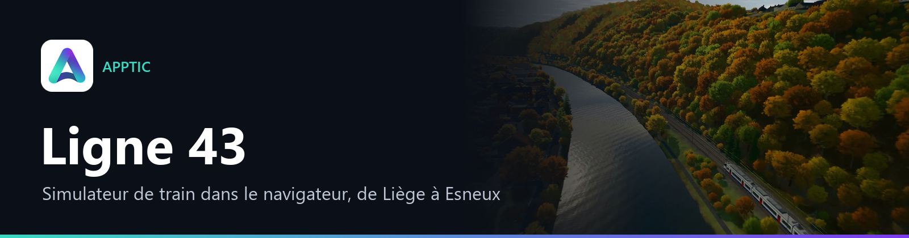

# Ligne 43

Un simulateur de conduite de train qui tourne dans le navigateur, sans rien installer. Le trajet va de Liège-Guillemins à Esneux : 15,9 km le long de l'Ourthe, six gares, sur ordinateur comme sur téléphone.

**Jouer : [ligne43.angleur.net](https://ligne43.angleur.net)**

> Le code source de Ligne 43 n'est pas publié. Ce dépôt en est la présentation.

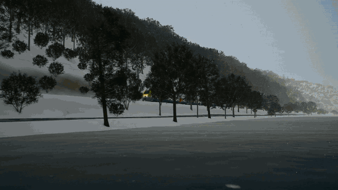

  <a href="https://www.youtube.com/watch?v=QClMe3G-2FE">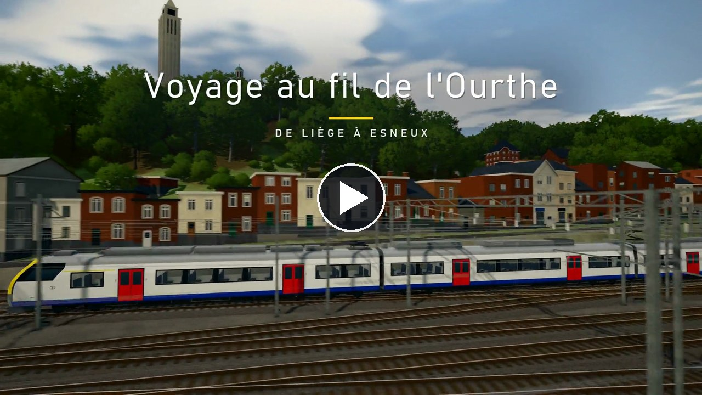</a>
   
  <a href="https://www.youtube.com/watch?v=QClMe3G-2FE">Voir la bande-annonce sur YouTube</a>

## Le projet

La ligne 43 remonte la vallée de l'Ourthe au départ de Liège. L'idée : la refaire rouler dans un navigateur, avec le vrai tracé, le vrai relief, les vrais bâtiments, et pouvoir s'asseoir à la place du conducteur.

Deux façons de faire le trajet :

- **La balade.** Le train roule seul. Il reste à choisir sa place : en cabine, côté fenêtre, au-dessus de la vallée ou en vue cinéma.
- **La conduite.** Cinq crans de traction, sept crans de frein, un horaire à tenir, des signaux à respecter. Un bilan attend à l'arrivée : ponctualité, précision des arrêts, vitesse, freinages.

## En images

  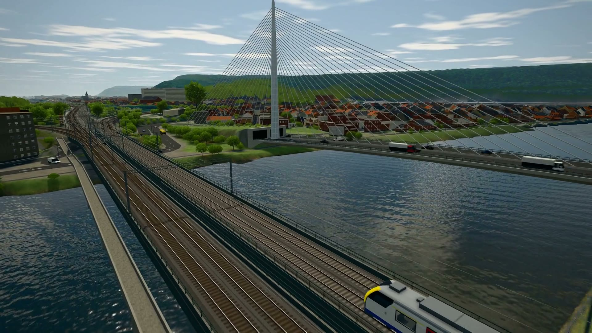
  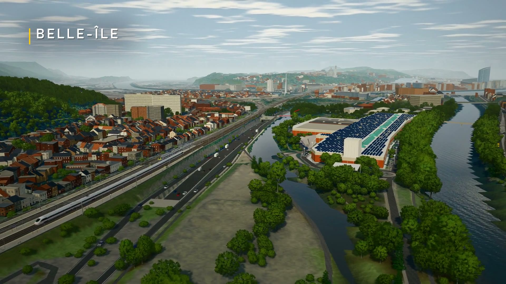

  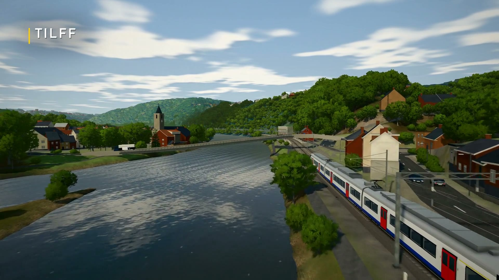
  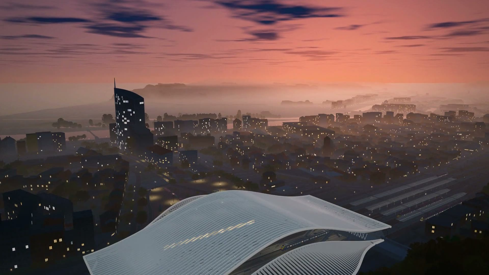

  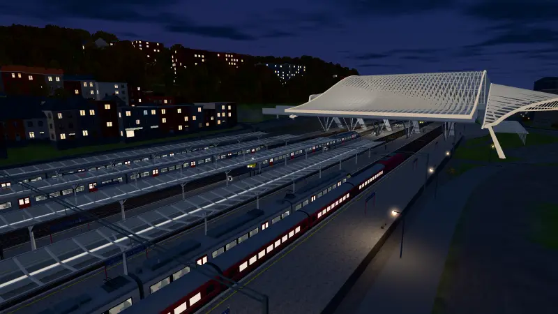
  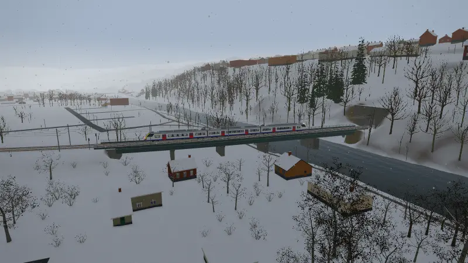
  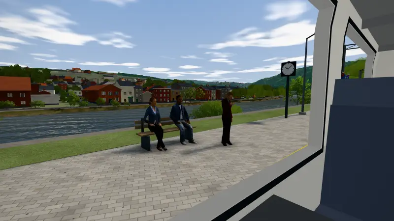

## Ce qu'il y a dans le jeu

- **Le trajet réel**, dans les deux sens : Liège-Guillemins, Angleur, Tilff, Méry, Hony, Esneux. Arrêts en gare, ouverture des portes, horaire.
- **Cinq caméras** : cabine, extérieur, dessus, cinéma, passager.
- **La signalisation** aux endroits où elle existe vraiment. Sur certains trajets, un signal reste fermé, annoncé par un double jaune. Le franchir déclenche un freinage d'urgence.
- **Un chantier** sur la voie, avec sa limitation à 40 km/h.
- **Le temps qu'il fait** : heure solaire, six météos, quatre saisons, nuit avec fenêtres allumées.
- **La vie autour** : autres trains, voitures et bus, voyageurs sur les quais, kayaks, pêcheurs et cyclistes le long de la rivière.
- **Des commandes tactiles** sur téléphone.

## Comment c'est fait

### Un monde reconstruit à partir de données ouvertes

Rien n'est dessiné au jugé. Le tracé des voies, les quais, les passages à niveau, les bâtiments, les routes et les cours d'eau viennent de données publiques. Le relief vient d'un relevé laser de la Wallonie. Une chaîne de scripts télécharge ces sources, les recale dans le même système de coordonnées, les corrige et produit le monde du jeu.

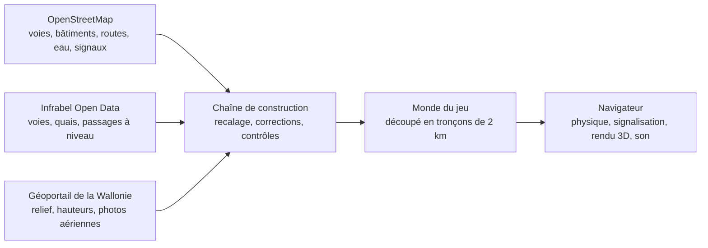

Les corrections comptent autant que les données : un relevé laser voit le tablier d'un pont et pas le sol dessous, certaines altitudes publiées sont fausses, et une projection cartographique déforme légèrement les distances. Chaque cas est traité et contrôlé par un script.

### Choix techniques

| Choix | Raison |
|---|---|
| **Aucun fichier son.** Le moteur, le roulement, le vent, la pluie : tout est synthétisé en direct par le navigateur | Le jeu reste léger, et le son suit exactement la vitesse, la traction et la caméra. |
| **Trains, gares et ponts construits par le code**, sans modèle 3D importé. La verrière des Guillemins est une géométrie calculée | Pas de fichier lourd à télécharger, et chaque objet se corrige en changeant un nombre. |
| **La physique du train est un module à part**, sans lien avec l'affichage : masse, effort de traction, résistance à l'avancement, pente sous le train, adhérence selon la météo | Elle se teste hors du navigateur, par script, à chaque changement. |
| **Le scénario des signaux se rejoue à l'identique** à partir d'une graine | Un trajet qui pose problème se reproduit exactement pour être corrigé. |
| **Le monde est découpé en morceaux** affichés selon la distance, avec trois niveaux de qualité | Le même jeu tourne sur un ordinateur de bureau et sur un téléphone. |
| **La page d'accueil pèse moins de 150 Ko.** Le jeu ne se télécharge qu'au clic sur « Démarrer » | La page s'ouvre tout de suite, même sur une connexion lente. |
| **Dix scripts de contrôle** vérifient physique, signaux et données avant chaque mise en ligne. Le script d'envoi refuse de partir si le build contient une carte de sources, un chemin local ou un outil interne | Une régression ou une fuite se voit avant la mise en ligne, pas après. |

### Technologies

| Partie | Technologies |
|---|---|
| Rendu 3D | Three.js (WebGL), post-traitement et reflets écrits pour le projet |
| Langage et outils | TypeScript, Vite |
| Son | Web Audio API, synthèse uniquement |
| Données | Scripts Node.js, proj4 pour les coordonnées Lambert 72 |
| Textures, arbres, accessoires | Blender piloté par scripts Python, sans intervention manuelle |
| Hébergement | Site statique |

## Versions

L'historique complet est dans [CHANGELOG.md](CHANGELOG.md). Version en ligne : 1.7.1.

## Sources et crédits

- © les contributeurs d'OpenStreetMap, sous licence ODbL
- Relief de la Wallonie 2021-2022 et orthophotos 2025 : Service public de Wallonie, Géoportail de la Wallonie
- Infrabel Open Data
- Personnages des gares : Microsoft Rocketbox, licence MIT
- Musique de la bande-annonce : création originale

Ligne 43 est un projet indépendant et non officiel, sans lien avec la SNCB ni avec Infrabel. Les noms et marques cités appartiennent à leurs propriétaires.

## Apptic

Ligne 43 est un projet d'[Apptic](https://apptic.be), studio de développement sur mesure installé à Angleur (Liège), réalisé pour [Angleur.net](https://angleur.net).

Autres projets : [Time Shifter](https://github.com/bastienbrasseur/apptic-timeshifter), planning des équipes de terrain · [Blue Box DAW](https://github.com/bastienbrasseur/bluebox-daw-versions), logiciel de mixage multipiste · [tous les projets](https://github.com/bastienbrasseur/apptic)

---

© 2026 Apptic. Tous droits réservés. Les textes et les images de ce dépôt ne peuvent pas être réutilisés sans accord écrit.
